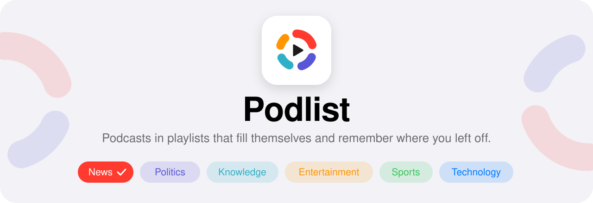
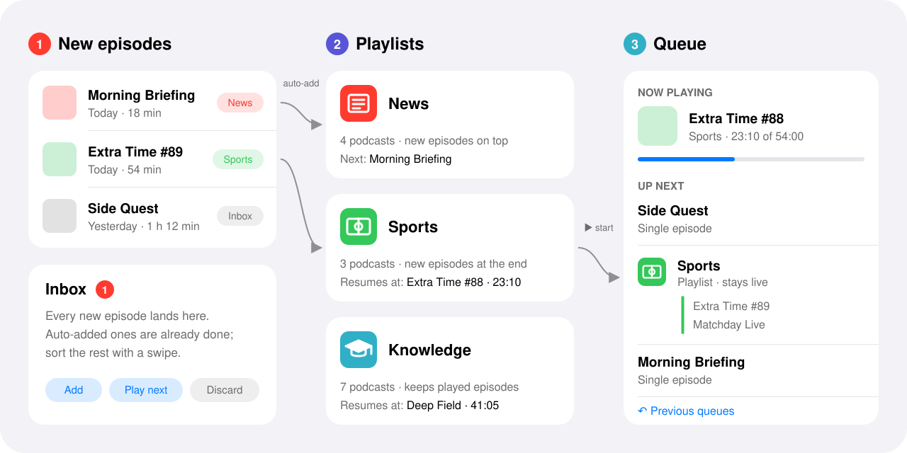
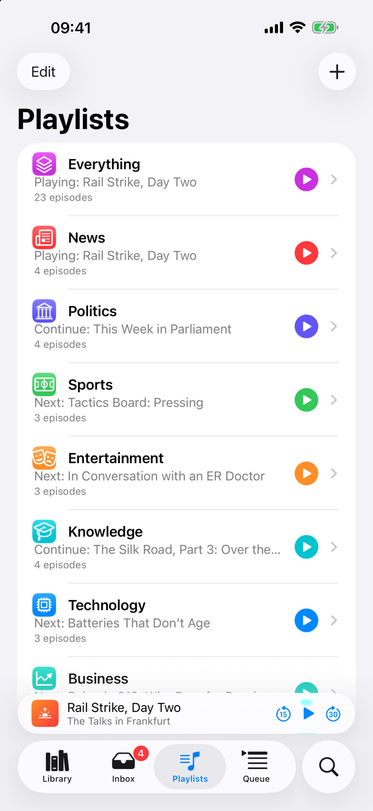
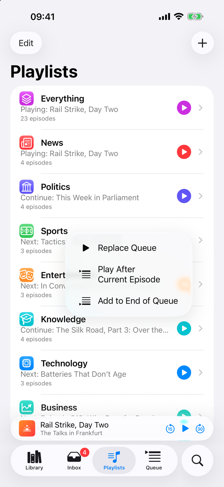
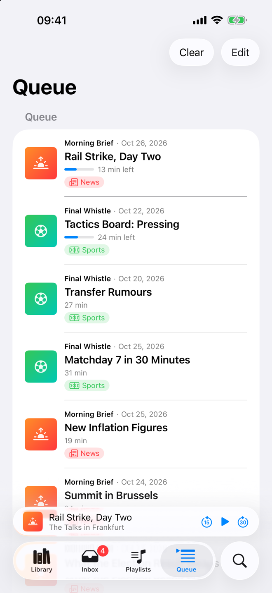
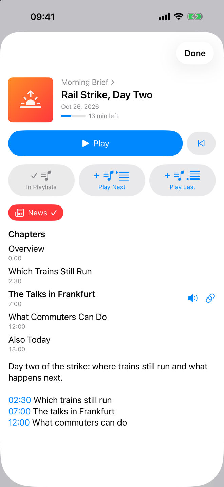
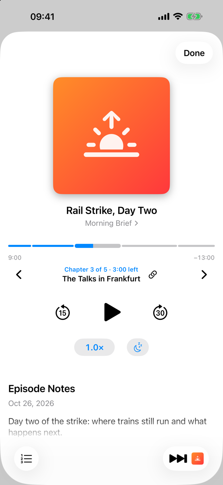
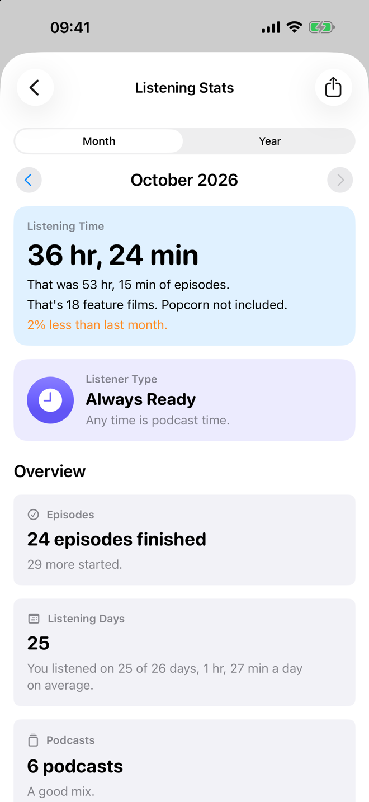
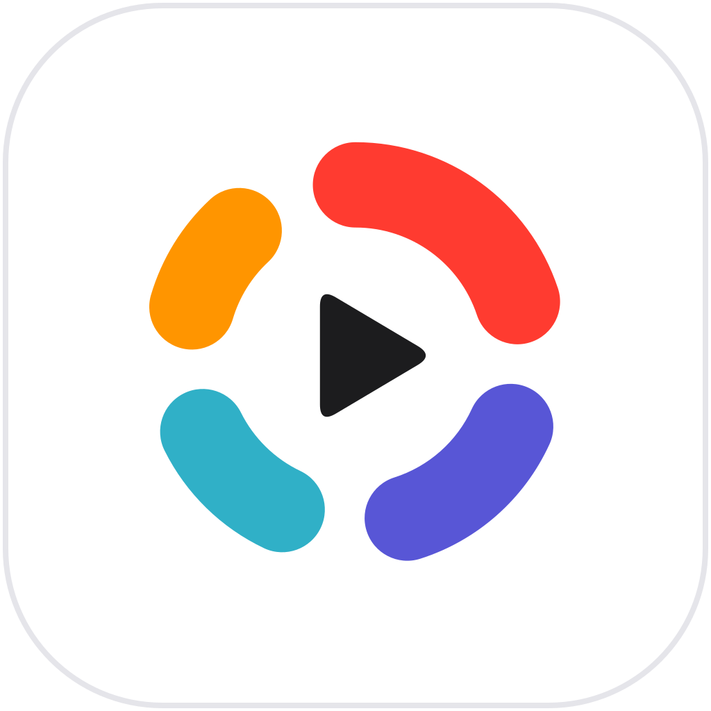

  

  
  
  
  
  

  <b>A podcast app for people who listen by topic.</b> 
  Sort your shows into themed playlists, let new episodes file themselves, 
  and pick up every playlist exactly where you left it.

  <a href="#why-podlist">Why</a> ·
  <a href="#who-its-for">Who it's for</a> ·
  <a href="#how-it-works">How it works</a> ·
  <a href="#screenshots">Screenshots</a> ·
  <a href="#features">Features</a> ·
  <a href="#private-by-design">Privacy</a> ·
  <a href="#status">Status</a>

  

## Why Podlist?

Most podcast apps give you **one queue**. Everything you subscribe to ends up in the same line: the morning news next to a three-hour history deep dive, last night's match analysis next to a course you are working through slowly. You end up rearranging the queue by hand, or you stop using it and scroll through a long list of new episodes instead.

But that is not how most of us listen. In the morning you want the news. On a long drive, something to sink into. After the weekend, sport. Your mood picks the **topic** first and the episode second.

Podlist is built around that idea:

- **Playlists are topics.** News, Sports, Knowledge, or whatever you make up. Each podcast belongs to one or more of them, and new episodes land there on their own.
- **Every playlist remembers where you were.** Switch from *Sports* to *Knowledge* in the middle of an episode, come back days later, and *Sports* continues exactly where you stopped.
- **One tap turns a playlist into your queue.** Start *News*, line up *Sports* after it, slip a single episode in between, drag everything into the order you like. Your playlists stay as they are, and nothing gets lost: every change can be undone.

## Who it's for

Podlist is for you if …

- 🎧 **you subscribe to more than a handful of shows** and your single queue has turned into a to-do list.
- 🗂️ **you listen by mood or occasion**: news while making coffee, long conversations on the train, sport after the weekend.
- ⏯️ **you jump back and forth** between topics and want each one to keep its place.
- 📚 **you work through archives or courses** and want a playlist that keeps everything, in order, played or not.
- 🔒 **you care about privacy** and want an app without an account, a cloud backend or analytics.
- 🔀 **you are coming from Pocket Casts, Overcast or Castro** and want to bring your subscriptions along in a minute.

## How it works

  

1. **New episodes arrive.** Each podcast is assigned to one or more playlists. For every assignment you decide whether new episodes are added at the top, at the bottom, or not at all. Every new episode also shows up in the **Inbox**, so you can sort the rest with a swipe.
2. **Playlists fill up and keep their place.** A playlist is a list of real episodes, sorted the way you like. It knows which episode it is playing or plays next, independent of everything else.
3. **The queue plays them.** Tap ▶ on a playlist and its episodes, from where you left off, become your queue. Line up another playlist after the current episode or at the end, add single episodes anywhere and drag them around. Every episode is in the queue only once. Switch to another playlist and the first one remembers where it stopped.

Two promises hold everywhere: **The queue never changes your playlists**, and **nothing you replace is gone**. The previous queue is one tap away.

## Screenshots

<table>
  <tr>
    <td align="center" width="33%"> <b>Playlists</b> Each one shows where it stands</td>
    <td align="center" width="33%"> <b>Start a playlist</b> Every playlist has its own ▶: tap to replace, long press for more</td>
    <td align="center" width="33%"> <b>Queue</b> Its own tab; one list, every episode once</td>
  </tr>
  <tr>
    <td align="center" width="33%"> <b>Episode details</b> Decide how to play, browse chapters</td>
    <td align="center" width="33%"> <b>Player</b> Chapters, speed, sleep timer</td>
    <td align="center" width="33%"> <b>Listening stats</b> Month and year (sample data)</td>
  </tr>
</table>

## Features

### 🗂️ Playlists

- Six starter playlists (**News, Politics, Sports, Entertainment, Knowledge, Technology**), each with its own color and symbol. Rename them, delete them, or create your own.
- A podcast can live in several playlists at once.
- When you subscribe, Podlist suggests playlists based on the podcast's category. One tap and you are done, or skip it.
- Sort by release date, duration, date added, title, by podcast (grouped) or manually by drag and drop.
- Decide per playlist what happens to played episodes: **remove** them automatically, or **keep** them, which is perfect for archives and courses you want to replay.
- Each playlist shows where it stands: *Playing*, *Next* or *Continue*. While it plays, its queued episodes sit on top (*In the Queue*), the rest below (*After That*).
- **Everything**: one more playlist with every episode of the others, most recently added first. Leave out playlists or podcasts you don't want in it.
- Hide playlists you rarely use behind **More**.

### 📥 Inbox

- Every new episode from all your subscriptions, newest first, with a badge for what arrived since your last visit.
- Episodes that were already auto-added appear as done, together with the playlists they landed in, so you can still add them somewhere else.
- Swipe to **add** to the podcast's playlists, **add to playlist …**, **play next** or **discard**, each with undo. Or add everything at once.
- Filter by playlist, or show only episodes from podcasts without a playlist.

### ⏭️ Queue

- One plain list of episodes, played from top to bottom. Every episode is in it **only once**.
- Tap ▶ on a playlist to play it right away: its episodes, from where you left off, replace the queue. Long press for more: **Replace**, **After the current episode** or **At the end**. Prefer to be asked every time? There is a setting for that.
- **Play next** and **Play last** for single episodes, from anywhere. An episode that is already queued moves instead of showing up twice.
- **The queue never changes your playlists.** Each playlist keeps its own order and remembers where it stopped, so you can start it again later right there.
- Replaced or cleared queues go into **Previous queues**. An undo banner appears right away, and shaking your phone works too.
- Tapping an episode opens its details instead of starting playback. Decide there: play now, queue it, or start the playlist from this episode.

### 🎙️ Player

- **Playback speed** globally and per podcast.
- **Skip intros and outros** per podcast, set once and forget about it.
- Adjustable skip intervals; the buttons on the lock screen and your headphones can jump by seconds or by chapter.
- **Sleep timer**: after a set time, at the end of the chapter, or at the end of the episode.
- Lock screen, Control Center and headphone controls.
- Every episode remembers its position. Finished episodes start from the beginning next time.
- **Next Episode** skips the current one and marks it as played, with undo.
- Show notes with tappable timestamps, right below the player.

### 📖 Chapters

Podlist reads chapters from **everything podcasters already publish**, with no extra work on their side:

| Source | Where it comes from |
|---|---|
| Podcasting 2.0 JSON chapters | linked from the feed |
| Podlove Simple Chapters | inside the feed, very common in German-language podcasts |
| ID3 chapters | inside MP3 files |
| MP4 / M4A chapters | inside AAC files |
| Timestamps in show notes | "12:34 Topic" lines in the episode description |

Chapter images replace the cover while the chapter plays, on the lock screen too. Chapter links open with a tap, the progress bar is split into chapters, and you can jump from chapter to chapter.

### ⬇️ Downloads & storage

- Download by hand or **automatically per playlist**, over Wi-Fi or cellular. iOS Low Data Mode is respected.
- Downloads of played episodes are deleted automatically (you can turn that off).
- A **storage overview** shows how much space your podcasts take, broken down by podcast, with the most useful action up front: **delete all played**.
- Pause, resume and retry downloads, and keep an eye on free space.

### 🔔 Notifications & background refresh

- Feeds refresh in the background, so new episodes are there when you open the app.
- Notifications for new episodes, on or off per podcast or for a whole playlist at once.
- Act right from the notification: **Add to playlists**, **Play next** or **Play last**.

### 📊 Listening stats

A monthly and yearly look back at your listening, informative and a little cheeky:

- Total listening time, in real time and in episode time, plus what that adds up to in everyday terms.
- Your top podcasts, your favorite playlist and genre, your longest streak and your record day.
- A heatmap of when you listen, and what kind of listener that makes you: *commuter*, *night owl*, *weekend listener* …
- How much time your playback speed saved, how often you fell asleep to which show, the oldest episode you dug up, and the subscriptions you have been neglecting.
- Share a summary as a story-format image.

All of it is computed on your phone from a local listening log.

### 🕰️ Listening history

- Every episode you started, by the day you last played it, with the parts you heard drawn as a bar.
- Filter by playlist, search, or look at what you listened to **a year ago**.

### 🚚 Moving in

- **Import your subscriptions via OPML** from Pocket Casts, Overcast, Castro and others. If a feed cannot be imported, Podlist tells you why.
- Search the Apple Podcasts directory and **ARD Sounds** in one list, or paste any feed URL. ARD Sounds shows without an RSS feed can be subscribed like any podcast.

### 📱 At home on iOS

- Built with standard iOS components: Liquid Glass, Dark Mode, Dynamic Type and VoiceOver work the way you expect.
- Your library as large tiles, small tiles or a list.
- Color is never the only signal: every playlist has a symbol, too.
- English and German, following your device language. Even the starter playlists are translated.

## Private by design

**Everything runs locally, and all your data stays on your iPhone.**

- **No account, no sign-up.** Open the app and start listening.
- **No Podlist server.** Your subscriptions, playlists, queue, listening positions and statistics live in a database on your device and nowhere else.
- **No analytics, no tracking, no ads, no third-party SDKs.**
- The app only talks to the network for what it needs: it loads feeds and audio **directly from each podcast's publisher**, and search queries go to Apple's podcast directory and to ARD Sounds.
- Background refresh and new-episode notifications run on your phone, not on a push server.
- Your listening stats are computed on the device. They only leave it if you share the image yourself.

## Status

Podlist is a personal project in active development. It is not on the App Store (yet). The source is public to read; no license has been chosen, so all rights are reserved.

Ideas for later include optional iCloud sync, iPad and Mac, Apple Watch, CarPlay, widgets, Siri and Shortcuts, transcripts, skipping chapters automatically, and OPML export.

### Building it yourself

You need **Xcode 26** and an iPhone or simulator running **iOS 26**. There are no dependencies to install.

1. Open `Podlist.xcodeproj`.
2. Select the `Podlist` scheme and an iOS 26 simulator, and run.

That is all you need for the simulator; no Apple account required. A Debug build in the simulator starts with a made-up sample library (podcasts, playlists, a queue and a listening history), and its episodes play silence of the right length, so you can try everything offline. Your changes stay; delete the app in the simulator to start over.

**On your own iPhone**, signing needs your team: in the `Podlist` target under *Signing & Capabilities*, pick your team and change the bundle identifier (`com.podlistapp.podlist` belongs to the App Store version), for example to `com.yourname.podlist`. A free Apple account is enough. On a device the app starts empty.

The logic lives in the local package `PodlistKit` and has its own tests, which run on the Mac without a simulator: `cd PodlistKit && swift test`. The UI tests run with the test plan `Podlist` in Xcode; they launch the app with `-uiTesting` (in-memory sample data, no network).

 

  

   
  <b>Podlist</b> · made for listening by topic · everything stays on your iPhone

