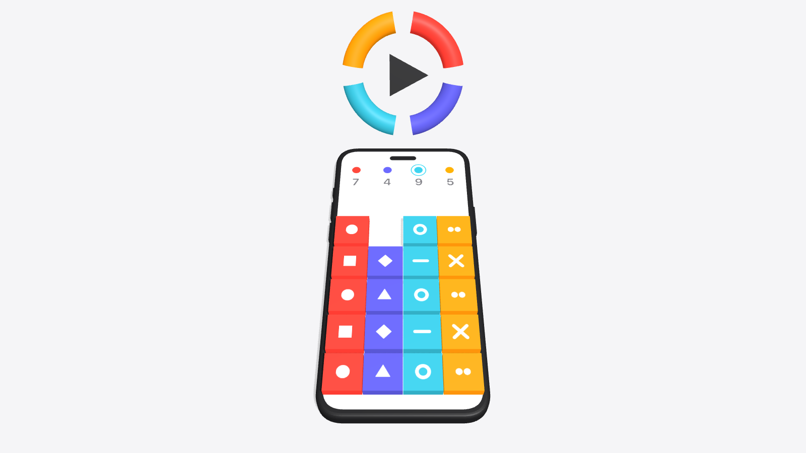
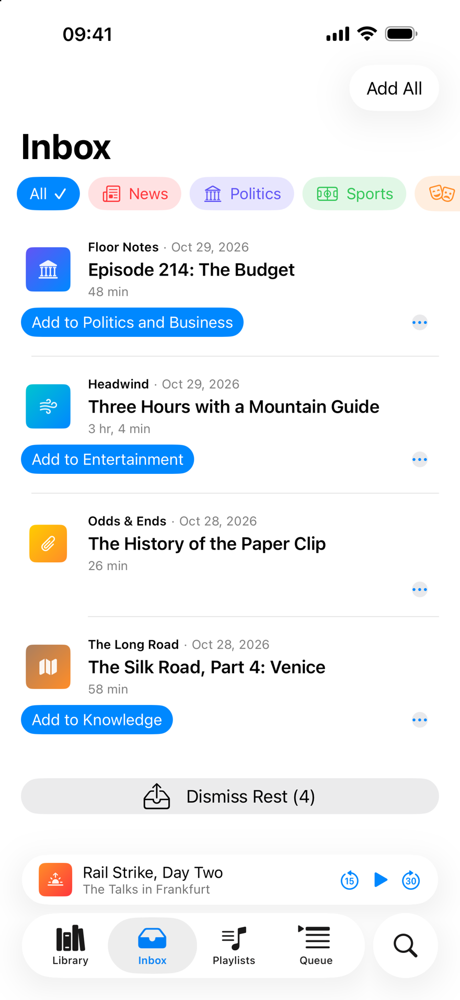
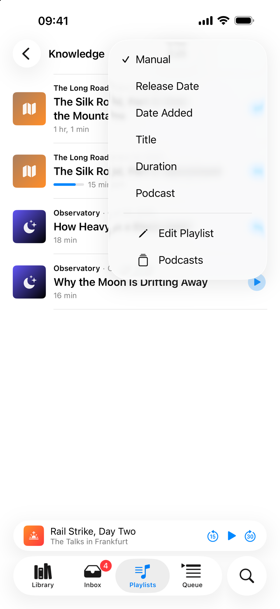

  <picture>
    <source media="(prefers-color-scheme: dark)" srcset="docs/readme/hero-dark.png">
    
  </picture>

<b>PODCASTS FOR POWER USERS</b>

<h1 align="center">A podcast app with playlists by topic.</h1>

  Podlist is for people with lots of subscriptions. 
  Every podcast belongs to one or more playlists, and you listen to the one that fits right now.

  <a href="https://apps.apple.com/app/id6822713541">
    <picture>
      <source media="(prefers-color-scheme: dark)" srcset="docs/readme/app-store-white.svg">
      
    </picture>
  </a>

  Free · iPhone · iOS 26 · English and German · No account 
  <a href="https://podlistapp.com/en/">podlistapp.com</a>

## One list for everything, or one playlist per topic.

In most apps, every new episode lands in the same queue. In Podlist, it lands in different playlists.

<table>
  <tr>
    <th>One list for everything</th>
    <th>One playlist per topic</th>
  </tr>
  <tr>
    <td valign="top">
      The Day in 15: Monday 
      Lab Radio 41: Cold, Part 2 
      Episode 86: The Mountain Guide 
      Extra Time after the Derby 
      The Day in 15: Tuesday 
      Why Bridges Sway 
      Coffee Break 212 
      Lab Radio 40: Cold, Part 1 
      The World Tonight
    </td>
    <td valign="top">
      <b>News</b> · The Day in 15: Monday · The Day in 15: Tuesday · The World Tonight  
      <b>Science</b> · Lab Radio 40: Cold, Part 1 · Lab Radio 41: Cold, Part 2 · Why Bridges Sway  
      <b>Interviews</b> · Episode 86: The Mountain Guide  
      <b>Light</b> · Extra Time after the Derby · Coffee Break 212
    </td>
  </tr>
</table>

## Some podcasts belong in two or more playlists.

So you assign them to several, and one tap puts each new episode into all of them.

1. **You assign the podcast to two playlists.** *The Long Conversation* goes into *Interviews* and *Science*.
2. **A new episode waits in the inbox.** *Episode 87: The Astronaut*, with the button *Add to Interviews and Science*.
3. **One tap puts it into both.** Each playlist picks up at its own place: *Interviews* continues with episode 86, *Science* with *Why Bridges Sway*.

## This is how it looks in the app.

<table>
  <tr>
    <td align="center" valign="top" width="33%"> <b>Playlists</b> Every playlist knows its place: “Playing”, “Continue” or “Next”. Tap ▶ to start one, touch and hold for Play After Current Episode or Play Last.</td>
    <td align="center" valign="top" width="33%"> <b>Inbox</b> Filter by playlist. One tap puts an episode into every playlist of its podcast; Dismiss Rest clears what is left.</td>
    <td align="center" valign="top" width="33%"> <b>Queue</b> The playing episode, single episodes and a started playlist. Drag to reorder.</td>
  </tr>
  <tr>
    <td align="center" valign="top" width="33%"> <b>Sorting</b> Per playlist by date, duration, title, podcast or by hand.</td>
    <td align="center" valign="top" width="33%"> <b>Listening stats</b> Month and year, computed on your iPhone (sample data).</td>
    <td></td>
  </tr>
</table>

**Everything** is one more playlist with every episode from all the others, newest first. You choose which playlists it includes.

## Free, no account, no data sent anywhere.

**Free.** No in-app purchases, no subscription, no ads. That won’t change.

**No account · No server · No tracking · No AI.** Everything stays on your iPhone. The app goes online only for feeds and audio, which come straight from each podcast’s publisher, and for searches in Apple’s podcast directory and ARD Sounds.

## Already using a podcast app?

Export your subscriptions as an OPML file and import it into Podlist. If a podcast can’t be added, Podlist tells you why. You can also search Apple Podcasts and ARD Sounds in one list, or add a feed by URL.

## What else Podlist does.

Sort by date, duration, title, podcast or by hand · “Everything”: every episode from all playlists · Listening stats · Listening history · Chapters from five sources · Speed per podcast · Skip intros and outros · Downloads per playlist · Notifications per podcast · Hide playlists · Undo

## FAQ

**Why not Apple Podcasts or Overcast?** 
Both are good apps, and if one queue works for you, you don’t need Podlist. Podlist is for lots of subscriptions listened to by topic: every podcast belongs to fixed playlists, new episodes only go there, and each playlist picks up at its own place.

**Is my data synced between devices?** 
No. Podlist stores everything on your iPhone and has no server to sync through.

**What can’t Podlist do?** 
Podlist runs only on iPhone with iOS 26 or later. There is currently no version for iPad, Mac, Apple Watch or CarPlay, and nothing is synced between devices.

**How do I find new podcasts?** 
With the search in the app. To browse by topic, try free podcast directories such as [Listen Notes](https://www.listennotes.com), [Podcast Index](https://podcastindex.org), [Podchaser](https://www.podchaser.com) or [fyyd](https://fyyd.de). Whatever you find there, search for it by name in Podlist or add it by feed URL.

**Will Podlist stay free?** 
Yes. There are no in-app purchases, no subscription and no ads, and that won’t change.

**Who’s behind it?** 
Podlist is a private project. It exists because no podcast app for iPhone fit more than 150 subscriptions listened to by topic and mood.

## The source

The source is public to read; no license has been chosen, so all rights are reserved. Podlist is written in Swift with SwiftUI and SwiftData, without third-party dependencies.

**Building it yourself.** You need **Xcode 26** and an iPhone or simulator running **iOS 26**. There is nothing to install: open `Podlist.xcodeproj`, select the `Podlist` scheme and an iOS 26 simulator, and run. No Apple account required.

A Debug build in the simulator starts with a made-up sample library (podcasts, playlists, a queue and a listening history), and its episodes play silence of the right length, so you can try everything offline. Your changes stay; delete the app in the simulator to start over.

**On your own iPhone**, signing needs your team: in the `Podlist` target under *Signing & Capabilities*, pick your team and change the bundle identifier (`com.podlistapp.podlist` belongs to the App Store version), for example to `com.yourname.podlist`. A free Apple account is enough. On a device the app starts empty.

The logic lives in the local package `PodlistKit` and has its own tests, which run on the Mac without a simulator: `cd PodlistKit && swift test`. The UI tests run with the test plan `Podlist` in Xcode.

 

   
  <b>Podlist</b> 
  Podcasts for Power Users. Free for iPhone on the <a href="https://apps.apple.com/app/id6822713541">App Store</a>.

